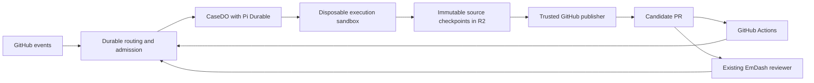

# EmDash bot implementation plan

Status: proposed bot implementation, prepared 14 October 2026. The template-based repository and starter Worker exist. Bot execution, Cloudflare resources, GitHub integration and evaluation commands have not been implemented.

Build an EmDash-specific service around Pi Durable, hosted on Cloudflare Durable Objects. The service must deliver useful fixes with less maintainer repair, preserve completed source changes when execution fails, and carry review findings through subsequent revisions. Implement it in this repository, independently of `infra/emdash-bot` in the EmDash monorepo. Use [ascorbic/worker-template](https://github.com/ascorbic/worker-template) as the foundation; the repository has been generated from its inspected revision `c735a72c77bb9b5f54ff7bfedba5ad86bfc4d978`.

This document defines the architecture, implementation order and acceptance gates. The template commands and configuration described below exist; bot modules, schemas and evaluation commands are proposed interfaces. Validate dependency APIs during the first slice before treating bot examples as executable instructions.

## Build order at a glance

1. Slice 1: `CaseDO` hosts Pi through `PiHarness`; a scripted case survives `ctx.abort()` and dedupes deliveries.
2. Slice 2: patch checkpoints in R2, sealed candidates and the trusted GitHub publisher; a scripted author's patch survives sandbox loss and response loss.
3. Slice 3: the real author with checkpointed tools over a Sandbox checkout; #4141 is the positive control and sets the budgets.
4. Slice 4: reviewer findings ledger, named verification jobs, check classification and exact-head readiness; #4074 is the revision control.
5. Slice 5: the evaluation controller, the full fault suite and the six quality cases.
6. Slice 6: a ten-case maintainer-assigned canary, then cutover.

Two gates block everything after them: any loss of acknowledged source or false completion in slice 2, and any critical delivery defect in the slice 5 fault suite.

## Decisions and scope

The implementation follows these decisions:

| Concern               | Decision                                                                                                         |
| --------------------- | ---------------------------------------------------------------------------------------------------------------- |
| Repository foundation | `ascorbic/worker-template`: Vite+, the `cf` CLI, `cloudflare.config.ts` and built-Worker tests in Miniflare.     |
| Agent execution       | Pi Durable owns model turns, tool tasks, conversation persistence and replay policy.                             |
| Hosting and ownership | SQLite-backed Durable Objects own case admission, durable routing and host wakeups.                              |
| Lifecycle adapter     | `PiHarness` from `agents/harness/pi` wakes the Durable Object and stores Pi state; no bespoke adapter.           |
| Repository execution  | Cloudflare Sandbox runs file operations, focused checks and browser reproduction.                                |
| Source preservation   | Immutable source checkpoints and candidates in R2 survive independently of a sandbox.                            |
| Publication           | Trusted Worker code publishes the saved candidate through GitHub APIs.                                           |
| Broad validation      | GitHub Actions runs expensive checks asynchronously against the exact published commit.                          |
| Code review           | Keep the existing EmDash reviewer; connect its findings to the author through a small adapter.                   |
| Model selection       | Keep provider and model configurable. Evaluate the new harness on its own; compare writer models only within it. |
| Initial intake        | A maintainer explicitly assigns a specific issue or implementation PR.                                           |
| Merge authority       | Human Maintainer approval remains required. The service never approves or merges its own work.                   |

Use Factory as reference material for GitHub ownership and feedback handling. Do not fork its complete workflow or add Flue, Agents SDK Tasks, a driver, or Cloudflare Workflows as a second scheduler around Pi. Host Pi through `PiHarness` from `agents/harness/pi`, the Agents SDK Lifecycle capability Cloudflare built with Earendil (announced 2 October 2026, beta). It supplies Durable Object SQLite storage and alarm-driven wakeups for Pi and nothing else; Pi owns agent execution. Cloudflare's own design notes record that a Tasks driver and a state machine were tried and discarded because Pi is already the durable execution engine, which is the same conclusion this plan reached.

The first release handles implementation issues and PR repairs. General-purpose agent hosting, replacement of the review bot, a new dashboard, autonomous opportunity discovery, dependency automation and release automation are outside this implementation. Browser tools are available for reproduction; screenshots are not a merge gate for these bot PRs.

## Requirements established by the investigation

The 14 October investigation identified independent delivery and coding failures. These are historical observations, not a measured failure rate for all PRs.

- [PR #4074](https://github.com/emdash-cms/emdash/pull/4074): a run produced the requested transaction changes and publish-handler regression, then failed during publication. Fresh recovery published the older candidate without those changes. Preserve the candidate and original revision requirements independently of the agent conversation.
- [PR #4070](https://github.com/emdash-cms/emdash/pull/4070) and [PR #4013](https://github.com/emdash-cms/emdash/pull/4013): actionable automated `COMMENTED` reviews did not independently start repair. Accept findings from the configured reviewer regardless of GitHub's aggregate review state.
- [PR #4106](https://github.com/emdash-cms/emdash/pull/4106): administrative check failures, including a GitHub 502 inside PR Maintenance, initiated coding work. Inspect exact-head evidence and classify the failure before requesting a code repair.
- The old completion report primarily established publication. Record candidate publication, validation, outstanding findings and human readiness separately.
- The writer also missed adjacent failure paths, localization and extraction contracts, plugin concurrency, and incomplete-migration tolerance. Delivery recovery cannot substitute for evaluating the quality of the published code.

The source inspection also found a relevant limitation in [Factory's author workflow](https://github.com/withastro/factory/blob/f186252add6b68627c12ef0c304bcb6fd61b0059/src/author/workflow.ts#L652-L664): completed edits live only in the container and are lost if it is replaced before publication. The replacement must prove a stronger source-preservation contract.

## Runtime and data flow

One case covers an issue and its resulting PR throughout implementation and revision. Adopting a PR with no originating issue creates a PR case. Container restarts, new commits and new review rounds do not create replacement cases.



Each completed source mutation records a checkpoint before returning success. A submitted candidate is sealed and immutable. Publication consumes that candidate; publication recovery does not re-enter the author to regenerate it.

### Ownership and event admission

Implement a small `RepositoryDO` for repository-scoped routing aliases and a delivery inbox. It performs deterministic routing, not model work. Register the bot-owned branch-to-case alias before publishing a branch so an early PR webhook can reach the correct case. Store issue and PR aliases as they become known.

Verify the webhook signature and installation/repository allowlist before admission. Authenticate maintainer assignment and directions, and the configured review actor, independently of text in a comment. The router durably records an accepted GitHub delivery before acknowledging it. Forwarding to `CaseDO` is retryable with the same delivery identifier. A delivery forwarded but not acknowledged is safe to forward again. Use immutable GitHub repository and entity IDs, rather than names alone, in case identity.

`CaseDO` admits events into Pi with a stable request identifier. Keep all accepted events. Coalesce redundant wakeups, but retain individual review findings, human directions and their provenance. A new event received during a turn remains pending for the next decision point.

Keep one writer active per case. Persist ownership and cancellation generations; reject tool completions and publication requests from an obsolete generation. Unassignment stops future work and cancels active jobs. If an external effect was already applied when cancellation occurred, reconcile and report it rather than attempting an automatic destructive undo.

`CaseDO` is a plain `DurableObject` with `Lifecycle.install(this).use(piHarness)`; it does not need to extend `Agent`, `routeAgentRequest` or WebSockets. The `harness` factory calls `Harness.open()` with the case's registry, settings and execution environment, so Pi's extensions, hooks and `env` remain under this repository's control. Pi's tables live in the same Durable Object SQLite under the `pi_` prefix; case tables sit alongside them so a checkpoint pointer, receipt and Pi commit share one transactional store. Address cases with `idFromName()` from immutable GitHub IDs; Lifecycle resolves the object name from `ctx.id.name` and rejects `newUniqueId()` objects.

`PiHarness` keeps one Lifecycle wake job per session: it heartbeats every 30 seconds while Pi has live tasks, reschedules to Pi's retry or poll deadline, re-arms on `onStart` after eviction, crash or a mid-run deploy, and hands off every 10 minutes because alarm invocations have a 15-minute wall-clock limit. Use the GitHub delivery ID as the submission `operationId`; a repeated submission returns `accepted: false` instead of a second run. Do not rely on in-memory timers, a shutdown hook, or one uninterrupted long request for correctness. Known limits to design around: a single model request that streams for more than 15 minutes can be cut off by the platform; background tasks are noticed at the next heartbeat; a custom task's `runtime.sleep` is invisible to the wake logic; the object never drains gracefully while a turn runs; and `abort()` waits for every in-flight tool to honour its signal.

### Author context

Build each author turn from the current repository state and a compact case record:

- The issue's acceptance criteria and original report, with their source links.
- Current branch head, current candidate and publication state.
- All outstanding review findings, including top-level review bodies and inline threads.
- Exact-head check evidence relevant to code repair.
- Previous attempts, failed hypotheses and verification receipts.
- Remaining round, time and token budgets.

The persisted conversation provides continuity. The case record is the authoritative source for task identity, outstanding requirements, cancellation, candidate selection and publication state. Conversation compaction cannot clear a finding or replace a candidate.

Load repository instructions, skill overrides and bot configuration from the maintainer-controlled default branch at a recorded commit. Candidate files cannot replace the instructions or permissions governing their own run. Respect authorised case scope; send privileged workflow/configuration changes to a separately authorised maintenance task rather than applying them through ordinary issue repair.

Let the author choose its investigative sequence. It may inspect code, reproduce a failure, edit, test or revisit a hypothesis. Do not split those choices into mandatory reproduce, diagnose, verify and fix model stages. Keep repository rules, acceptance criteria and tool authority outside model-editable summaries.

### Source checkpoints and candidates

Represent each checkpoint as one immutable artifact in R2: a binary patch of the staged working tree against the recorded base commit, produced with `git add -A && git diff --binary --cached <sourceBaseCommit>`. That format carries deletions, file modes, renames and binary files, and a clean checkout of the base commit materialises it with `git apply --index`; verify the result with `git write-tree`. Take the diff from the index after `git add -A`, because a working-tree diff silently omits untracked files, and always pass `--binary`, because `--full-index` alone applies only when the blob already exists locally. Do not build a content-addressed blob and manifest store; candidates here are small diffs and a single artifact per checkpoint keeps the two-phase commit and garbage collection trivial. A sandbox filesystem and its Git index are derived copies. Generated dependencies and build outputs belong to environment caches, not the authoritative source checkpoint.

For each accepted edit:

1. Validate the operation against the current source checkpoint and serialize source mutations within the case.
2. Upload the immutable patch artifact to R2 under a key derived from its digest.
3. Commit the artifact pointer and operation receipt in the case's durable state.
4. Return success only after the pointer is committed. Materialize or repair the sandbox from that pointer as needed.

R2 and Durable Object storage do not form one distributed transaction. Upload immutable objects first and commit their pointer second. A crash can leave unreferenced objects for later garbage collection; it must not leave a committed pointer to missing source. Keep an operation ID so an interrupted edit reconciles its existing receipt instead of applying the edit twice. Validate repository-relative paths, file modes and artifact size before importing or materializing source; do not follow candidate symlinks outside the checkout.

The tool environment wraps Pi's file operations and command execution. A command that modifies source captures those changes before returning its result, including when its exit status is nonzero. A process interrupted before this checkpoint has an explicit interrupted outcome; restore the latest acknowledged checkpoint. Do not promise to resume an arbitrary process or preserve unacknowledged intermediate filesystem writes.

Seal a candidate from an acknowledged checkpoint. The following fields describe the proposed candidate record; `sourceTreeHash` is the `git write-tree` result of applying the artifact to `sourceBaseCommit`. Verification and publication receipts are separate records so the candidate stays immutable:

```typescript
interface Candidate {
	id: string;
	caseId: string;
	ownershipGeneration: number;
	parentCandidateId: string | null;
	sourceBaseCommit: string;
	expectedBranchHead: string | null;
	sourceTreeHash: string;
	artifactDigest: string;
	artifactKey: string;
	requirementsRevision: number;
}
```

The seal operation checks complete artifact availability and digest consistency. Tests on candidate A do not become evidence for candidate B. A branch change or rebase produces a new candidate and triggers the required verification and review again.

### Publication and external effects

Prefer GitHub's Git Data APIs to create blobs, trees and commits from the saved candidate. Publish without executing candidate code in a credentialed environment. The sandbox receives no GitHub write credential and no bot/provider secret. Private checkout access must be read-only and removed before agent tools run. Restrict sandbox outbound network to the package registry and the read-only GitHub access that preparation needs; issue bodies and comments are untrusted model input, so an unrestricted sandbox is an exfiltration path for the checkout. The Sandbox SDK can disable internet access entirely (`enableInternet: false`); establish the narrowest allowlist that still prepares dependencies in slice 3.

Before each effect, record a durable intent with an operation ID, case, candidate, expected branch state and deterministic desired result. Record commit metadata before creating the commit so recovery can identify the same intended commit. Update existing branches only by fast-forward; never force-push contributor work.

If the branch has advanced, determine whether the intended commit was already applied or whether a new candidate is required. Preserve intervening contributor commits. Attempt a clean integration once; a conflict hands off to a human. Never reuse prior verification on the integrated candidate.

For a lost push or PR-creation response, query GitHub and reconcile the remote state before retrying. A successful branch update followed by a failed report leaves the publication receipt intact. Identify bot-created PRs through their repository, case branch and bot-authored metadata, and avoid creating a duplicate. Use updateable operation markers for deterministic status reports and check results.

Do not claim general exactly-once delivery across GitHub and the bot's database. Test each operation for duplicate delivery, response loss and applied-but-unacknowledged effects. If an ambiguous review reply cannot be reconciled confidently, surface it for inspection rather than posting repeated replies.

### Verification and review findings

Publication is an intermediate result. Preserve imperfect candidates as draft PRs so normal CI can evaluate them. Broad tests, root build, formatting, lint and type checks run through maintainer-owned workflows against the exact candidate, in the order required by the target repository. Focused checks run in the sandbox when they give useful feedback within budget.

A verification receipt records the source tree, published commit where applicable, command or workflow identity, environment digest, outcome, timestamps and log artifact. Queued, running, cancelled, skipped, failed and successful are distinct outcomes. A skipped required check counts only when its documented applicability rule permits it.

Read a failed check's exact head and relevant logs before classification. The initial categories are code failure, infrastructure failure, administrative/human gate, cancellation, stale result and unknown. Only a supported code failure starts author repair. Unknown results retain the candidate and request investigation or human input. Comparing check names with main is insufficient to establish a shared failure.

Do not automatically rerun workflows in the initial production configuration. The configured service may observe subsequent runs, reconcile transient API reads and report a concrete next action. Add any retry authority separately after evaluating it.

The existing reviewer remains the reviewer. Implement an adapter that authenticates the configured review App/account and reads the relevant body and threads for the reviewed commit. Change the reviewer to emit a machine-readable findings block alongside its human-readable review, for example a fenced JSON block in the review body or a check-run output, carrying a stable finding ID, location, severity and the reviewed commit. The adapter reads that block and retains the raw review as evidence. Do not build a markdown normalizer or an ambiguity hand-off path for reviewer output; the reviewer is maintained alongside this bot, and a structured contract is cheaper and more reliable than parsing prose. A `COMMENTED` review with actionable findings must initiate repair even when CI is green. Bot status reports must not become new review instructions.

Give each finding a stable source identity and track `open`, `addressed-by-author`, `confirmed-by-reviewer`, `disputed` and `needs-human`. An author claim or a GitHub thread-resolution flag alone does not confirm a fix. Carry open and disputed findings across commits. Ask the independent reviewer to assess the new head; preserve an explicit disposition for every earlier finding.

Emit deterministic case status from recorded evidence. The initial statuses are `working`, `candidate-published`, `waiting-for-checks`, `changes-required`, `ready-for-human`, `needs-human`, `cancelled` and `terminal`. They describe observable state; they are not a separate multistage model workflow. A new finding invalidates readiness. Missing human approval does not initiate code repair.

`ready-for-human` requires current-head applicable code checks, independent review with no unresolved actionable or disputed finding, and a fresh mergeability assessment. Display outstanding human approval separately. An administrative approval gate is not a failed code check and does not prevent accurately reporting that the code is ready for human assessment.

## Template foundation and development workflow

Keep the template's single-package structure and checked-in lockfile. The package and Worker are named `emdash-bot`; `src/index.ts` is the entrypoint. Preserve the `with { type: "cf-worker" }` import attribute in `cloudflare.config.ts` so the config can infer the Worker exports and `Env` bindings.

- Declare Worker settings, Durable Object bindings/migrations, R2 buckets and Sandbox/container configuration through the supported `cf/config` schema in `cloudflare.config.ts`. Verify the relevant APIs in slice 1; do not add a parallel `wrangler.jsonc` configuration.
- Keep compatibility date and flags in `compatibility.ts`, shared by the Worker config and `test/harness.ts`.
- Use Vite+ through the existing `pnpm dev`, `pnpm check`, `pnpm fix`, `pnpm test` and `pnpm build` scripts. `pnpm check` covers formatting, lint and type checking. Tests import from `vite-plus/test`.
- Run `pnpm types` after binding changes. Generated `Env` and runtime declarations live in ignored `.cloudflare/types/`; `postinstall` also regenerates them.
- Extend `test/harness.ts` to load the built Worker in Miniflare with matching DO and storage bindings. `test/global-setup.ts` builds once before tests. Use this harness for Worker/DO recovery tests, then prove actual platform behavior in the deployed staging suite.
- Keep the Vite/Vitest overrides in `pnpm-workspace.yaml` aligned with Vite+, and Miniflare aligned with `cf` and the Cloudflare Vite plugin. Change these pins together and rerun the recovery suite.

The template's test and semantic-PR-title workflows remain. The optional Claude assistant workflow has been removed; the Pi author and existing EmDash reviewer are the planned agent services. Retain `AGENTS.md` and its `.claude/CLAUDE.md` symlink as the repository instructions.

Use Node 24 to match the template CI and the pnpm version pinned in `package.json`. Start with `pnpm install --frozen-lockfile`, then run `pnpm check`, `pnpm test` and `pnpm build` after scaffold changes. These checks establish a working foundation, not bot correctness.

Deployment uses the existing `pnpm deploy` script (`vp build` followed by `cf deploy --prebuilt`). Account selection, staging resources and credentials remain slice 1 work. Configure production Workers Builds only at the canary stage, with an empty build command and `pnpm run deploy` as the deploy command. GitHub Actions runs bot checks and manually dispatched eval orchestration; candidate verification in EmDash remains separate.

## Execution environment and tools

Use the template's Node toolchain, pnpm and lockfile in this repository. Pin tested `agents`, Pi Durable, pi-ai and Chord releases together; `PiHarness` requires Pi packages at 1.0 or later and its API is expected to change while Pi Durable matures. The inspected Pi packages were version 1.2.0 and `agents` was 0.28.1; verify the registry artifacts and Worker bundle in slice 1, and record the bundle cost of `agents` (it depends on `esbuild`, Babel decorator plugins, `capnweb` and `partysocket`; Chord also installs `esbuild`, which a Worker never reaches). Treat an upgrade of any of these as an explicit change requiring the recovery suite and saved-session compatibility checks.

Do not adopt `@cloudflare/computer` as the source store or tool set. Its SQLite-backed workspace validates the direction of keeping authoritative source outside the sandbox, but the package is preview-only, holds the container-side filesystem in memory, is documented as unsuitable for full monorepos, and routes container I/O through FUSE. The checkpointed tools here wrap Pi's own `ExecutionEnv` over a real Sandbox checkout.

Adopt the current Sandbox SDK 1.x API after checking its actual image and Worker configuration. Do not copy the existing bot's 0.12 client or a stale skill example into the new code. Add Chromium and the existing browser tooling when the first browser case requires them. Keep large image processing inside the execution environment rather than the Worker.

Prepare a checkout environment keyed by repository snapshot, lockfile, Node/pnpm versions, container image, platform and build configuration. Restore dependencies from that cache and refresh affected declaration/build output for the candidate before a focused test depends on it. Never count stale `dist` output as validation. Use frozen-lockfile installation for normal work; dependency changes are explicit candidate changes.

Container snapshots accelerate preparation. They do not establish source correctness or replace immutable candidate artifacts. A cache miss performs one bounded bootstrap or hands off with a setup diagnostic. Avoid repeated full install/build recovery loops.

The initial tools cover repository read/search, checkpointed write/edit, bounded shell execution, browser inspection when configured, named focused checks, asynchronous verification submission/status, candidate submission and explicit handoff. The author cannot approve, merge, force-push or issue arbitrary GitHub write requests.

Every case tool declares `replay` explicitly and honours `context.abortSignal`. Mark only reads, searches and whole-file writes `replay: "safe"`; the checkpointed `edit`, `bash`, named jobs and publication tools are `"unsafe"` so an interrupted call returns an interrupted result instead of running twice. Shell calls are not replay-safe by default. Named jobs use durable IDs so recovery checks an existing job before starting another. A tool marked replay-safe must reconcile its own external effects. Returning the same Pi submission ID does not establish that a subprocess or GitHub operation ran only once.

Every run has required limits for setup, active author time, individual jobs, total elapsed time, token spend and revision rounds. A job deadline covers sandbox attachment, readiness, source materialization, recovery and the subprocess, rather than starting only after those preparations finish. Also bound cancellation and cleanup. Choose initial values from the first two staging cases, freeze them before the comparison, and record them in each run manifest. Start live operation at one active case; raise concurrency to two after measuring resource contention. Waiting for CI releases the sandbox and active model execution, but still counts toward elapsed time.

## Proposed repository layout

Extend the existing template package. Create bot directories as their slices require them; the layout is not a request to scaffold empty modules or build a reusable framework. `Dockerfile`, bot module directories and `evals/` below remain proposed.

```text
README.md
IMPLEMENTATION_PLAN.md
AGENTS.md
package.json
pnpm-lock.yaml
pnpm-workspace.yaml
cloudflare.config.ts
compatibility.ts
vite.config.ts
tsconfig.json
Dockerfile
.github/workflows/
  test.yml
  semantic-prs.yml
src/
  index.ts
  cases/           # Durable ownership, inbox, requirements and observed status
  runtime/         # PiHarness factory, Pi registry and model-provider wiring
  github/          # Routing, context, publication and review/check adapter
  source/          # Patch checkpoints and sealed candidates
  execution/       # Sandbox environment, named jobs and environment preparation
  tools/           # Case-scoped author tools
  reports/         # Deterministic progress, readiness and handoff reports
skills/
  emdash-author/   # Target-repository method and useful test entry points
test/
  global-setup.ts  # Build the Worker once before integration tests
  harness.ts       # Built Worker in Miniflare; match configured bindings
  index.test.ts    # Starter Worker smoke tests
  tsconfig.json
  unit/
  workers/
  recovery/
evals/
  controller/     # Provision, trigger, observe, interrupt, grade and resume
  cases/          # Public task fixtures and private grader manifests
  scripts/        # Scripted agent used for deterministic delivery tests
  workflows/      # Trusted controller and grading workflows
  results/        # Ignored local result bundles
```

Use Vitest through Vite+ for pure tests and the template's Miniflare harness for Worker/DO tests. Extend that harness as bindings are added. Validate this repository with `pnpm check`, `pnpm test` and `pnpm build`. Agent-generated EmDash changes must satisfy EmDash's checks through the candidate verification path; a bot-package build is not their substitute.

## Implementation slices

Implement these slices in order. Each slice has an observable exit gate. A failing gate is work to fix before expanding the system.

### Slice 1: Pi hosted in a case

Build on the existing template scaffold. Replace the starter routes in `src/index.ts` with the service entrypoint; add SQLite-backed `CaseDO` hosting `PiHarness`, routing admission and the Pi registry. Declare bindings and migrations in `cloudflare.config.ts`, regenerate types, and add matching bindings to `test/harness.ts`. Verify `agents`, Pi and Sandbox configuration against the template's pinned `cf`/Vite plugin versions before adding their dependencies. Confirm that this repository's Miniflare-from-Node harness is sufficient for Lifecycle alarms and SQLite; the Agents SDK's own tests use `@cloudflare/vitest-plugin` (formerly `vitest-pool-workers`), which this repository does not adopt. Add one scripted tool and one read-only model turn. Verify provider routing through the selected gateway, persisted usage and cancellation. Record dependency, bundle-size and image provenance; no production repository access is needed.

Persist and resume the same case through an abrupt DO reset. Deduplicate webhook deliveries and Pi submissions. Verify an event arriving during a turn remains pending and an unassigned generation cannot continue to use tools.

Exit: `PiHarness` runs in this repository's build and Miniflare harness; a scripted case survives `ctx.abort()` mid-turn and resumes from the wake alarm; duplicate deliveries with the same `operationId` dedupe; an event arriving during a turn remains pending; an unassigned generation cannot continue to use tools; the case finishes with an inspectable transcript and event log; and the adapter's bundle cost is recorded. One read-only deployed model turn uses the intended model/provider and no sandbox.

### Slice 2: Saved source and trusted publication

Implement patch checkpoints, acknowledged edit receipts, sandbox materialization, candidate sealing and the GitHub publisher. Use a tiny fixture repository and a scripted author to produce a known patch. Publish a draft PR, with no real coding model and no EmDash full-suite run.

Inject the two faults that correspond directly to #4074: destroy the sandbox after a candidate is sealed, and lose the response after a branch update has applied. Assert source hashes, remote commits, receipts and report accuracy. The remaining boundaries (after a completed edit, after commit creation, after PR creation, and a maintainer advancing the branch mid-run) belong to the slice 5 fault suite, after the slice 3 execution adapter has settled where the checkpoint hooks sit.

Exit: the intended patch survives sandbox loss without model reconstruction; response loss creates no duplicate commit or PR; a reporting failure does not erase publication. Any loss of acknowledged source or false completion blocks slice 3.

### Slice 3: Real author and prepared execution

Implement Pi's execution-environment adapter and case-scoped tools. Add the EmDash author skill using the target repository's current instructions and useful test entry points. Prepare dependencies and exact-source focused verification. Add browser tools only for cases that need them.

Run a historical #4141 fixture as the first positive control. Use the original starting source and report, not the merged fix. Exercise a fresh environment once, then compare restored setup and focused-check timings. Measure the per-tool-call checkpoint cost (sandbox diff, R2 upload and Durable Object commit) in the first real run, since it multiplies across every file-changing tool call. Choose explicit budgets from this evidence.

Exit: a real author produces a saved candidate that passes the independently prepared behavior test and publishes it through the slice 2 executor. The receipt identifies the source actually tested. Preparation and cancellation have bounded failure behavior.

### Slice 4: Review repair and asynchronous CI

Implement the existing-reviewer adapter, durable finding records, named verification jobs, check classification and exact-head readiness. Route check and review events back to the same case. Re-read live PR state before each revision.

Run a #4074 revision fixture with its original incomplete candidate and review. Interrupt after the repair candidate is sealed, then recover publication. Require a new independent review of the published head. Add #4106-style administrative checks and a GitHub 502 to prove they do not request code edits.

Exit: the requested transaction behavior and publish-handler regression are in the published source; every original finding has an explicit disposition; a green check cannot erase a finding; old checks cannot validate a new commit; infrastructure failure preserves the candidate without a repair loop.

### Slice 5: Reproducible evaluation controller

Implement the controller described below. Reuse useful fixture, HMAC-delivery and observation code from the existing implementation smoke runner after inspecting its behavior. Replace diagnosis-anchor scoring and PR-creation-only acceptance with artifact and recovery grading.

Run the scripted recovery suite locally, then a smaller real deployed suite. Run #4141 and #4074 on Pi before spending model runs on the full set. Produce independent grading bundles and an anonymized diff-review queue.

Exit: an interrupted controller resumes the same attempt; a failed bot run remains visible in results; private grading inputs stay unavailable to the author; each result is attributable to pinned code, model, inputs, source and budget. Only then run the six quality cases.

### Slice 6: Maintainer-assigned canary and cutover

Deploy a production profile only after the evaluation gates pass. Start with a small batch, initially ten maintainer-assigned tasks, at one active case. Inspect every failure and handoff. Confirm the bot identity and its permitted EmDashBot issue-work scope against the target repository's policy. Use the target implementation PR template and accurate AI disclosure.

Choose one writer for each adopted case. Existing issues and PRs continue with their existing owner unless a maintainer explicitly assigns a takeover. Preserve contributor branches and authorship. Do not attach both writers to the same case during the canary.

Rollback disables new intake and cancels or drains the new writer; saved candidates, traces and receipts remain inspectable. Re-enable the old writer only after resolving ownership. Retain the old deployment through the canary. Remove the old writer after successful held-out evaluation and canary review, with no active old cases; retain the existing review service.

Exit: no critical delivery defect, lower observed maintainer repair effort, acceptable elapsed times under the frozen budgets, and explicit human approval to complete cutover. Ten cases alone do not establish a general failure-rate claim.

## Evaluation controller

The controller is a Node/TypeScript operator program that runs locally or in a manually dispatched GitHub Action. Agents run in Cloudflare; the Action coordinates and grades them. Long-running attempts are external durable runs, so controller restarts do not restart the agent.

Use dedicated staging Workers for the initial evaluation, with separate DO namespaces, artifact buckets and sandbox resources. Provision scoped disposable repositories under `emdash-cms`. Current Worker Previews can isolate DOs, but their container support needs an explicit capability check before using them instead of the known staging layout.

### Case and run manifests

A case contains the pinned source, task input and independent acceptance criteria. Historical PR numbers identify fixtures, not current live readiness.

- Starting repository commit, optional original candidate tree and required environment recipe.
- Frozen issue body, authorised directions, review bodies and threads at the chosen starting point.
- Behavior boundaries, adjacent invariants and supported-dialect requirements to grade.
- Normal verification commands and the private grader's tests and expected original failure.
- Event sequence, fault boundary, expected recovery result and explicit run budget.
- Whether a fix, request for information or human handoff is the acceptable outcome.

Resolve the actual starting SHAs while preparing each fixture. Demonstrate that its grading test fails on that source for the intended reason and accepts at least one reviewed repair. Keep the reference patch and private tests in controller storage, outside the bot's repository clone, credentials and prompts. Accept correct alternative implementations; do not grade similarity to the reference diff.

A run manifest additionally records harness source/deployment version, dependency lock and image digests, requested model/provider and reported usage metadata, prompt/skill hashes, case-input digest, attempt ID, seed when supported, faults, concurrency, cache state and limits. Use observed provider metadata when available; do not imply the requested model proves every backend routing decision.

Do not build an old-harness evaluation arm or add fixture adapters to the existing bot. Its defects are documented above as concrete delivery failures and need no paired measurement, and six cases cannot estimate a rate for either harness. Fixture overrides come from the authenticated controller's recorded manifest and enter through the normal application path; they are unavailable in production. If a historical state cannot be replayed faithfully, report the case as not reproducible rather than substituting a direct-agent run. Prevent future repository history and reference repairs from being included in the starting checkout.

### Attempt lifecycle

The controller performs the following operations:

1. Provision or reset an isolated fixture repository and allocate a fresh case identity. Share immutable preparation caches where appropriate, never task state or mutable workspaces.
2. Seed the issue and original PR state. Register the staging review actor so feedback has the same authority checks as production. Reference answers remain hidden.
3. Trigger the normal assignment/webhook path and record its durable admission receipt. Avoid direct Pi dispatch for end-to-end scores.
4. Observe structured events and authoritative remote state. Store the controller's own progress so it can reattach to the same attempt.
5. Inject an armed fault once at its named boundary. Fault controls are compiled only into the staging profile, authenticated, scoped to a run, and absent from production.
6. Wait for a terminal outcome or readiness within the case deadline. At timeout, cancel underlying jobs and record the timed-out attempt rather than silently resubmitting it.
7. Fetch the exact published commit and run the private grader in a clean checkout. Run private tests after the author settles; do not feed their failures back as ordinary CI during a held-out score.
8. Collect normal CI, reviewer findings, the final finding ledger and an anonymized diff for human assessment. Preserve failed attempts and all repairs as separate evidence.
9. Write the result bundle before cleaning resources. Retain failed artifacts for a configured inspection period; cleanup only bot-owned disposable resources.

Normal CI and the existing reviewer provide feedback during the author's allowed rounds. Private grading evaluates the final artifact separately. Run grading workflows from trusted controller source and execute candidate code without publication, bot/provider or production credentials.

### Fault suite

Most cases use a scripted author and fake external adapters under Vite+ Vitest, with Worker/DO behavior exercised through the Miniflare harness. A smaller deployed suite uses real storage, a real sandbox and GitHub in the disposable repository. Graceful eviction tests and abrupt-reset tests are distinct; use local eviction helpers for lifecycle behavior and a staging-only `ctx.abort()` boundary for abrupt reset. A caught exception alone does not simulate process loss.

| Fault                                             | Required evidence                                                                       |
| ------------------------------------------------- | --------------------------------------------------------------------------------------- |
| Duplicate or out-of-order delivery                | One case owner; all unique directions retained; no duplicated visible work.             |
| Reset after an acknowledged edit                  | Restored source tree contains the edit and the original requirement.                    |
| Sandbox loss after candidate sealing              | Publisher consumes the same artifact without calling the model again.                   |
| R2 upload succeeds before pointer commit fails    | Recovery uses the last committed pointer; no missing referenced artifact.               |
| Push applies before response is lost              | Same intended commit is reconciled; no replacement patch or duplicate PR.               |
| Reporting fails after publication                 | Publication receipt survives and the report is repaired independently.                  |
| Review arrives during a turn                      | It remains in the inbox and blocks readiness until disposition.                         |
| Trusted actionable COMMENTED review with green CI | Repair starts and retains the findings across commits.                                  |
| Maintainer advances the branch                    | Contributor work survives; integration creates a newly verified candidate or hands off. |
| Administrative, stale or cancelled check          | No unsupported source repair and no false readiness.                                    |
| Cancellation during a tool or publication         | Obsolete generations stop; already-applied effects are reconciled accurately.           |
| Lost verification callback                        | A named existing job is inspected rather than duplicated or forgotten.                  |
| Controller interruption                           | Observation resumes the same scored attempt without hiding its failure.                 |

### Quality cases and run order

The initial development set is deliberately small:

| Historical case | Behavior to evaluate                                                                                     |
| --------------- | -------------------------------------------------------------------------------------------------------- |
| #4141           | Straightforward table-paste fix and ordinary publication.                                                |
| #4074           | Transactional redirect cleanup, actual publish-handler regression and interrupted revision delivery.     |
| #4070           | Field metadata cleanup restricted to column-add failure, preserving later-error behavior.                |
| #4013           | Provider help with localization, extractor coverage and public export documentation.                     |
| #4095           | Plugin-scoped concurrency and the relevant runtime-readiness error boundary.                             |
| #4024           | System-table classification without substring false positives or loss of incomplete-migration tolerance. |

These cases can reject a design but cannot establish an unbiased overall quality rate. After tuning, freeze the implementation and add new held-out cases, including an insufficient-information report and an intended-behavior report where no code change is correct.

Run the deterministic suite first. Then run #4141 and #4074 on Pi once each; stop for a critical delivery defect. If both pass, run all six cases once under the frozen budgets at low concurrency. Repeat uncertain cases rather than selecting the best attempt.

Only then compare writer models, holding instructions, tools, starting source and budgets fixed. Record the runtime/provider differences that remain uncontrolled. Expand hold-out coverage when the initial results justify it; do not begin with a large model-by-case sweep.

The proposed CLI is a slice 5 deliverable. These commands do not exist yet:

```sh
pnpm evals recovery --target local
pnpm evals recovery --target pi-staging
pnpm evals run --case 4074 --target pi-staging --fault after-candidate-saved
pnpm evals run --suite initial-six --target pi-staging
pnpm evals resume --attempt <attempt-id>
```

Give profiles explicit endpoints, repository allowlists, resources and budgets. Read credentials from local secret storage or Actions secrets, never from case files or command-line literals. A profile targeting `emdash-cms/emdash` is not an evaluation profile. Any future live canary is an explicit operator action with a separate profile.

### Grading and decision gates

Grade the final published artifact and observed delivery, rather than the author's summary. Classify each attempt as accepted without human repair, accepted after human repair, correct handoff, incorrect/false completion, or stalled/failed. Negative cases have their own acceptable-outcome score and do not inflate the fix-success denominator.

Acceptance of a fix requires issue criteria, private behavioral tests, relevant adjacent invariants, exact-head required checks and independent review without substantive human correction. Changesets, public API documentation and localization are graded when applicable. Bot screenshots remain waived. Human diff reviewers do not see the model or harness name.

Report attempted and completed counts, unattended accepted fixes, handoff quality, delivery failures, human repair minutes, author rounds, token cost and elapsed time. Break time into preparation, model work, tool/job execution, CI queue/execution and review waiting. Include failed and timed-out attempts in the overall outcomes. For the small initial sample, show individual runs, median and worst observed time; do not present a precise tail estimate or significance claim.

The implementation gates are:

- Zero acknowledged-source loss, contributor overwrite, duplicate PR creation or false completion in the fault suite. Any such defect blocks expansion.
- Unattended acceptance on the six cases and the held-out cases, with handoffs and failures reported rather than masked, and maintainer repair effort recorded per case. Inconclusive results require a targeted repeat or more cases.
- Held-out results and canary assessment support the same direction under the agreed budgets. Higher PR creation alone is not improvement.

Normal bot CI runs fast recovery tests. The manually dispatched evaluation workflow runs deployed faults and paid model cases. A dependency/runtime change runs the recovery suite before promotion; a prompt, tool or model change runs the relevant quality cases. Avoid repeating expensive unchanged suites after their gates pass unless a new change or failure justifies it.

## Operations and maintenance

Emit structured events for admission, turn start/end, tool intent/result, checkpoint commit, candidate seal, publication intent/receipt, verification state, review finding, readiness, cancellation and handoff. Include case, attempt, operation and source identities. Keep logs and artifacts bounded and exclude credentials. Record preparation and subprocess time separately so a fast test inside a slow attach is visible.

Provide an operator CLI to inspect a case, export its evidence, cancel work and explicitly resume an eligible interrupted operation. Inspecting or reconciling is read-only unless the operator selects an authorised action. Recovery follows saved work and receipts; a new coding attempt is a new recorded author round.

Keep rejected or disputed findings visible. A handoff states the current candidate, failing boundary, remaining requirements, last successful verification and concrete next action. Do not repeatedly notify about unchanged queued checks or known blockers. A merged or closed PR ends tracking; it does not trigger cleanup of contributor branches.

Garbage collection deletes unreferenced checkpoint artifacts and expired environment caches only after a grace period. Preserve referenced candidates, in-flight intents and retained evaluation evidence. Take backups and test restoring case records together with their referenced artifacts before production cutover.

## Decisions to resolve during implementation

Resolve these at their named slice and record the result in this document:

| Decision                                                                                     | Resolve in                                                                                                                                                                                                                                                                                                                                            |
| -------------------------------------------------------------------------------------------- | ----------------------------------------------------------------------------------------------------------------------------------------------------------------------------------------------------------------------------------------------------------------------------------------------------------------------------------------------------- |
| Cloudflare account, AI Gateway and staging resource names                                    | Slice 1; use the existing project context without copying production secrets into tests.                                                                                                                                                                                                                                                              |
| Tested `agents`/`PiHarness`, Pi release, Sandbox 1.x image and Worker compatibility settings | Slices 1–2; pin artifacts after deployed capability tests.                                                                                                                                                                                                                                                                                            |
| Fallback writer if Pi quality disappoints                                                    | Slice 5; `ContainerHarness` (`agents/harness/container`) runs Claude Code or Codex in a Container behind the same `prompt()`/`submit()`/`wait()` interface with credentials injected outside the container, so a writer swap is a bounded change rather than a rewrite. Owning the author loop, tool authority and checkpointing remains the default. |
| Initial writer model and actual gateway routing                                              | Slice 1 for the smoke; select the writer from slice 5 evidence.                                                                                                                                                                                                                                                                                       |
| Existing review service's machine-readable findings block                                    | Slice 4; add the block to the reviewer and keep the change limited to the feedback adapter boundary.                                                                                                                                                                                                                                                  |
| Historical fixture SHAs and independent behavior tests                                       | Before each quality case runs.                                                                                                                                                                                                                                                                                                                        |
| Setup, author, job, case and spend budgets                                                   | Slice 3 smoke; freeze before the paired evaluation.                                                                                                                                                                                                                                                                                                   |
| Live bot identity, assignments and permitted issue participation                             | Slice 6 before enabling production intake.                                                                                                                                                                                                                                                                                                            |

None of these requires creating a generic agent framework. Implement the concrete EmDash contract and leave a reviewed decision where measurements or existing interfaces are still needed.

## Sources and implementation references

The following were inspected on 14 October 2026. Pin implementation dependencies separately; upstream documentation may change.

- [Worker template at the inspected revision](https://github.com/ascorbic/worker-template/tree/c735a72c77bb9b5f54ff7bfedba5ad86bfc4d978): repository foundation, `cf/config`, Vite+, shared compatibility settings and built-Worker Miniflare tests.
- [Pi Durable README at the inspected revision](https://github.com/earendil-works/pi/blob/1692bba6347a287ab0f3cb554a4430fafffc474b/packages/durable/README.md): tool replay, persisted submissions, execution environments, task ownership and DO SQLite storage. The package explicitly labels its API experimental.
- [Pi Durable Object SQLite adapter](https://github.com/earendil-works/pi/blob/1692bba6347a287ab0f3cb554a4430fafffc474b/packages/durable/src/storage/sqlite/cloudflare.ts): existing storage adapter; `PiHarness` wraps it with a `pi_` table prefix.
- [PiHarness changelog post](https://developers.cloudflare.com/changelog/post/2026-10-02-pi-harness/), [PiHarness docs](https://developers.cloudflare.com/agents/harnesses/pi/), [extensions](https://developers.cloudflare.com/agents/harnesses/pi/extensions/) and [Lifecycle](https://github.com/cloudflare/agents/blob/main/docs/agents/lifecycle.md): the Durable Object host for Pi, its wake job, recovery behaviour and limits. Beta; API expected to change.
- [Pi harness example notes](https://github.com/cloudflare/agents/blob/main/examples/next/harnesses/pi/NOTES.md): Cloudflare's record of the rejected Tasks/driver/state-machine designs, the 15-minute alarm hand-off, in-memory Pi timers and other unresolved items.
- [`@cloudflare/computer`](https://www.npmjs.com/package/@cloudflare/computer) README (0.5.1): preview-only workspace with in-memory container filesystem; inspected and not adopted.
- [ContainerHarness example](https://github.com/cloudflare/agents/tree/main/examples/next/harnesses/container): Claude Code or Codex in a Container behind the shared harness interface; the recorded fallback writer.
- [Factory author workflow](https://github.com/withastro/factory/blob/f186252add6b68627c12ef0c304bcb6fd61b0059/src/author/workflow.ts) and [feedback selection](https://github.com/withastro/factory/blob/f186252add6b68627c12ef0c304bcb6fd61b0059/src/author/feedback.ts): reference for ownership and rounds, with the inspected container-only edits and other-bot feedback limitations.
- [Sandbox snapshots](https://developers.cloudflare.com/sandbox/files/save-and-restore-a-workspace/): filesystem restore semantics; snapshots do not preserve memory or running processes.
- [Durable Object lifecycle](https://developers.cloudflare.com/durable-objects/concepts/durable-object-lifecycle/) and [abort API](https://developers.cloudflare.com/durable-objects/api/state/#abort): activation, reset and abrupt-fault behavior.
- [Worker Preview resources](https://developers.cloudflare.com/workers/previews/resources/): current DO isolation and partial container support; older notes saying all DO previews are unavailable are outdated for the newer Preview feature.
- [First #4074 repair report](https://github.com/emdash-cms/emdash/pull/4074#issuecomment-6124017660) and [recovery report](https://github.com/emdash-cms/emdash/pull/4074#issuecomment-6124365436): historical publication-recovery case.
- Existing EmDash checkout at `52dfe3f3c39ad5305553d88058c35e49c094c959`: inspect `infra/emdash-bot/evals/bin/implementation-smoke.ts`, `evals/src/runner.ts`, `evals/src/scorer.ts`, the author skills, `AGENTS.md`, `AI_POLICY.md` and the PR template before porting useful pieces. The checked-in diagnosis runner bypasses the application orchestrator and its score is not a mergeable-patch metric.
